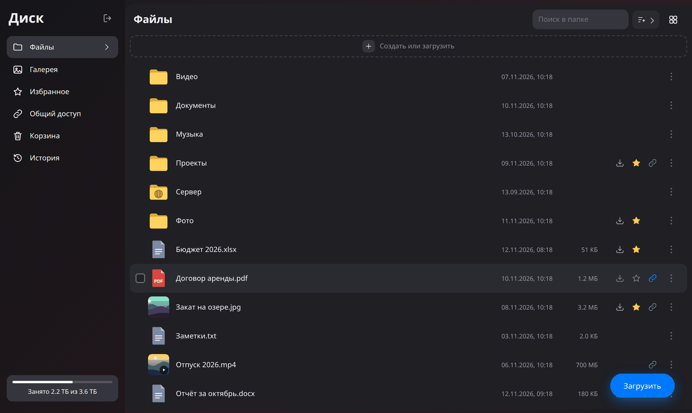
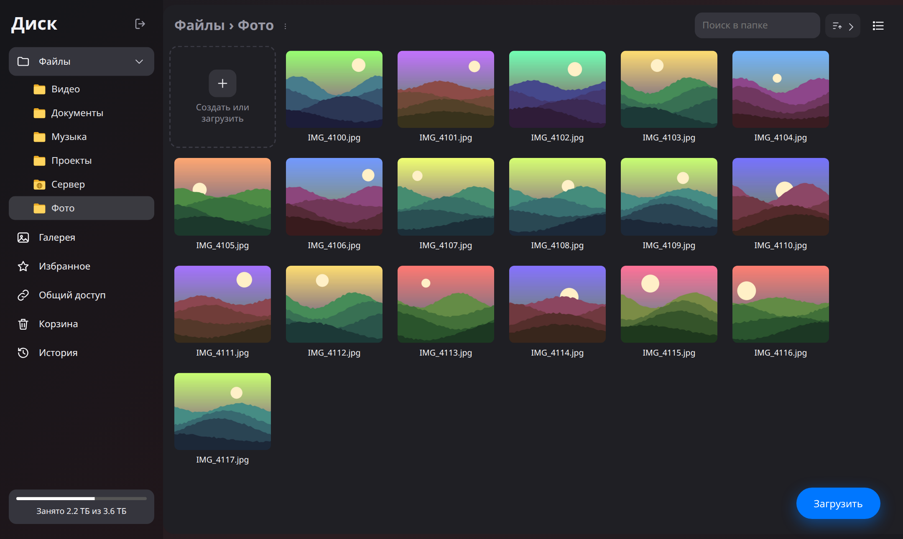
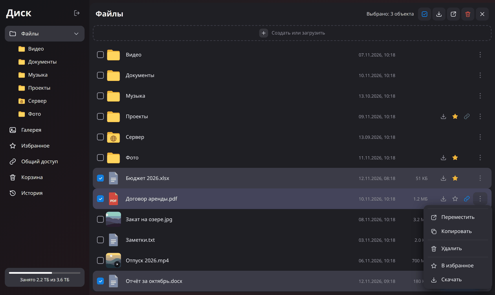
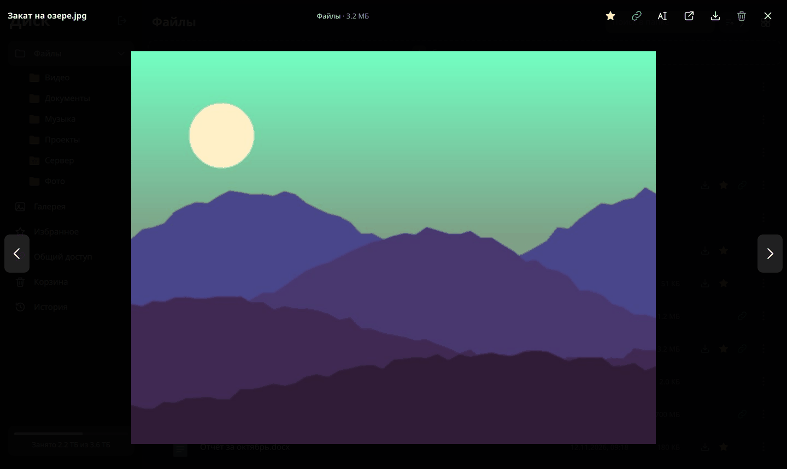
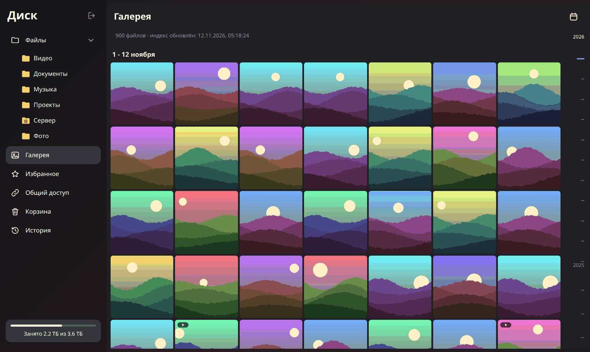
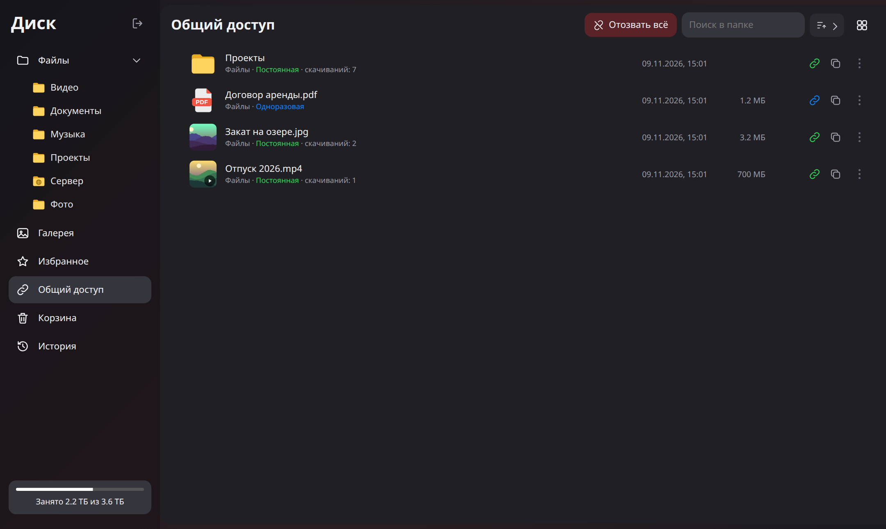
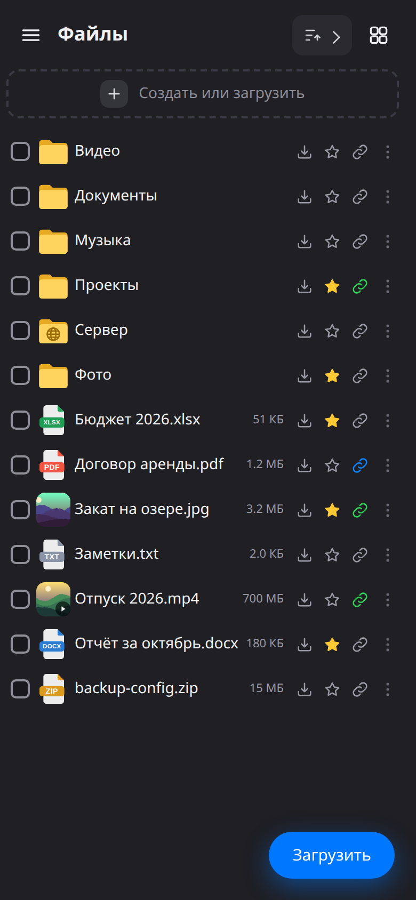
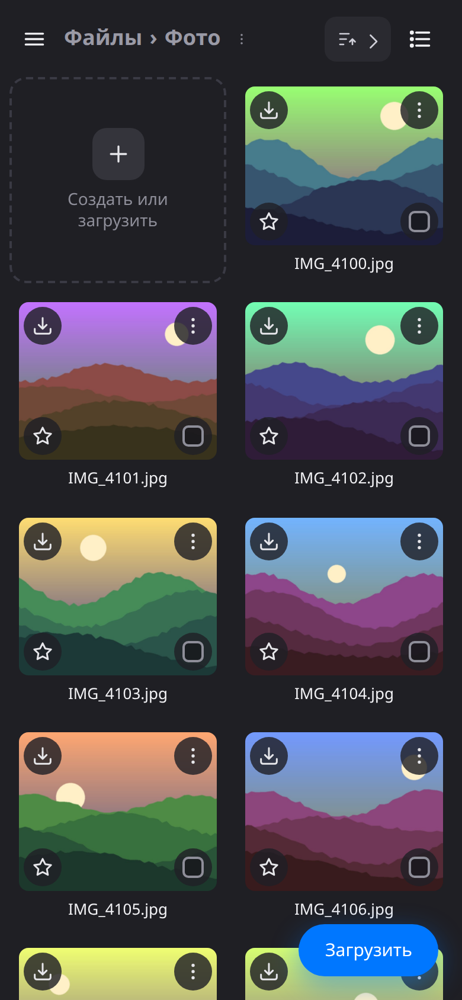
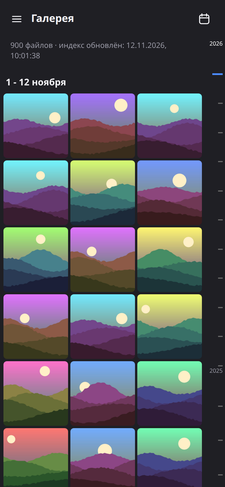
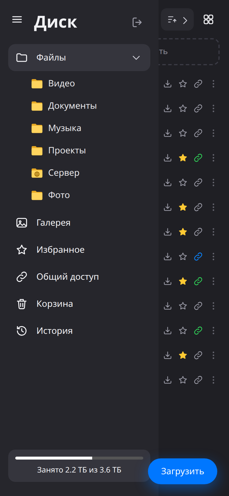

# PHP-NAS

Лёгкий веб-интерфейс «Диск» для домашнего NAS на Windows: Apache + PHP (FastCGI), без отдельного сервера баз данных (только SQLite). Дизайн в духе Яндекс Диска и Облака Mail.ru, адаптивная вёрстка для телефона.

> Проверено на Windows и на Linux. Это тестирование UI с минимальным, пользовательским функционалом! Авторизация, многопользовательский режим, права доступа на уровне FS и прочие корпоративные плюшки типа MSSQL, LDAP, Почта — за донаты в другой версии.

## Что умеет

Это личное «облако» на своём сервере: открываете адрес NAS в браузере (с компьютера или телефона), входите по паролю и работаете с файлами так же, как в Яндекс Диске или Облаке Mail.ru. Ничего устанавливать на компьютеры и телефоны не нужно.

| Раздел | Для чего |
|---|---|
| **Файлы** | Все папки и файлы NAS: просмотр, загрузка, скачивание, переименование, перемещение, копирование, удаление |
| **Галерея** | Все фото и видео лентой по дням, как в телефоне: шкала времени и календарь для быстрого перехода к нужной дате; правая кнопка — «В избранное», «Поделиться» |
| **Избранное** | Файлы и папки, отмеченные звёздочкой, — быстрый доступ к нужному без поиска по папкам |
| **Общий доступ** | Ссылки, которые вы дали другим людям: копирование ссылки, отзыв доступа, «Отозвать всё» |
| **Корзина** | Удалённое: можно вернуть на прежнее место или удалить навсегда |
| **История** | Кто, что и когда загрузил, удалил, переместил, скачал по ссылке; фильтр по типу действия и дате |

## Как это выглядит

Снимки сделаны на тестовых данных.

### Компьютер

| | |
|---|---|
|  |  |
| **Файлы, список.** Звёздочка — в Избранном, значок ссылки — открыт общий доступ, папка с планетой — папка-ссылка на другой диск или шару | **Файлы, плитки.** Миниатюры фото и видео, дерево папок слева |
|  |  |
| **Выбор нескольких объектов.** Панель «Выбрано: N» и меню «⋮» для всех выбранных | **Просмотр.** Листание стрелками, «В избранное», «Поделиться», скачать, удалить |
|  |  |
| **Галерея.** Лента по дням, шкала дат справа | **Общий доступ.** Постоянные и одноразовые ссылки, число скачиваний |

### Телефон

| Файлы | Плитки | Галерея | Меню |
|---|---|---|---|
|  |  |  |  |

## Как пользоваться

### Файлы и папки

- **Одно нажатие — выделение, два — открыть.** Одинарный клик (или тап на телефоне) выделяет объект, двойной открывает: папку — в списке, файл — в просмотрщике. Так случайное нажатие ничего не скачивает. Клик по пустому месту списка снимает выделение, Enter открывает выделенный объект. Так же работают Избранное, Общий доступ и Корзина.
- **Файлы без просмотрщика** (архивы, программы и т. п.) по двойному нажатию открывают окно с иконкой, размером, датой и кнопкой «Скачать».
- **Вид:** кнопка справа вверху переключает список и плитки. Рядом — сортировка (по названию, дате, размеру, по возрастанию или убыванию) и поиск по текущей папке.
- **Переход по папкам:** двойной клик по папке открывает её; в дереве папок слева — одинарный. Путь сверху («хлебные крошки») и дерево папок в левом меню возвращают на любой уровень. Стрелка у папки в дереве есть, только если внутри есть подпапки.
- **Загрузка:** кнопка «Загрузить» внизу справа, плашка «Создать или загрузить» над списком или просто перетащите файлы и папки в окно браузера. Клавиши: Shift+I — файлы, Shift+U — папка, Shift+F — новая папка.
- **Действия с объектом:** меню «⋮» у файла или правая кнопка мыши — «Просмотреть», «Скачать», «Переименовать», «Переместить», «Копировать», «Удалить», «В избранное», «Поделиться». Повторное нажатие на «⋮» закрывает меню. Действия с текущей папкой — кнопка «⋮» рядом с её названием в пути.
- **Скачивание:** файл скачивается как есть, папка — ZIP-архивом.

### Выбор нескольких объектов

- Отметьте чекбоксы у нужных объектов. Также работают Ctrl+клик и Ctrl+A, Esc снимает выбор, Delete удаляет выбранное, F2 переименовывает (если выбран один объект).
- Пока что-то выбрано, вместо поиска и сортировки сверху появляется панель: «Выбрано: N», синяя кнопка «Выделить все» и действия раздела, справа — «Отменить выбор». Если выбрано уже всё, повторное нажатие на «Выделить все» снимает выбор и закрывает панель.
- Выбор есть во всех разделах с просмотром, кроме Галереи и Истории:

| Раздел | Действия с выбранным |
|---|---|
| Файлы | Скачать, Переместить, Удалить |
| Избранное | Скачать, Убрать из избранного |
| Общий доступ | Скачать, Скопировать ссылки, Отозвать доступ |
| Корзина | Восстановить, Удалить навсегда |

- Меню «⋮» и правая кнопка мыши выбор не меняют: если объект среди выбранных, меню действует на все выбранные, иначе — только на этот объект.

### Просмотр

Фото, видео, аудио, PDF, текстовые файлы, документы Word и таблицы Excel открываются прямо в браузере по двойному нажатию, без скачивания. Стрелки (или ← →) листают файлы папки, внизу — путь и размер, вверху — «В избранное» (звёздочка), «Поделиться» (значок ссылки, цветной, если доступ уже открыт), скачать, переименовать, переместить, удалить. Так же просмотрщик работает в Галерее, Избранном и Общем доступе.

**Превью вместо значков.** В Файлах, Избранном, Общем доступе и Корзине у фото и видео показываются миниатюры. Для фото миниатюра создаётся при первом показе, для видео — только если она уже есть в кэше (после `pregen.php` или Галереи), иначе виден обычный значок. При удалении в Корзину миниатюры переносятся вместе с файлом и возвращаются при восстановлении. Delete удаляет открытый файл, F2 — переименование, Esc — закрыть.

**Значки по типу файла.** У каждого файла свой значок: светлый лист с цветным уголком и цветной плашкой с расширением (PDF, DOCX, XLSX, ZIP, MP3 и т. д.). Цвет зависит от группы:

| Цвет | Группа | Расширения (примеры) |
|---|---|---|
| красный | PDF | pdf |
| синий | Документы | doc, docx, odt, rtf, pages |
| зелёный | Таблицы | xls, xlsx, ods, csv, numbers |
| оранжевый | Презентации | ppt, pptx, odp, key |
| серый | Текст | txt, log, md, ini, conf, srt |
| фиолетовый | Код и разметка | json, xml, html, js, css, php, py, sh, ps1, sql, yml |
| жёлтый | Архивы и образы | zip, rar, 7z, tar, gz, iso |
| розовый | Аудио | mp3, m4a, flac, ogg, wav |
| сиреневый | Видео | mp4, mov, mkv, avi, webm |
| бирюзовый | Изображения | jpg, png, gif, webp, heic, tif, psd, raw |
| тёмно-серый | Программы | exe, msi, dmg, apk, deb, rpm |
| прочие | Почта, шрифты, книги, ярлыки | eml, ics, ttf, epub, djvu, torrent, url |

Файлы с неизвестным или слишком длинным (больше 5 символов) расширением получают общий значок листа со строками. Одни и те же значки используются в Файлах, Избранном, Общем доступе и Корзине, а также в окне файла без просмотрщика. У фото и видео вместо значка показывается миниатюра, если она есть (см. выше). Список расширений и цветов — в `FT_TYPES` в `icons.js`.

### Избранное

Нажмите на звёздочку у файла или папки (или «В избранное» в меню) — объект появится в разделе «Избранное». Там те же поиск, сортировка и вид, что в «Файлах»; одинарный клик выделяет, двойной открывает папку или файл в просмотрщике, после закрытия вы остаётесь в Избранном.

- Меню «⋮» (или правая кнопка): «Открыть», «Показать в папке», «Скачать», «Убрать из избранного», «Поделиться».
- У объектов с открытым доступом виден цветной значок ссылки (в списке — рядом со звёздочкой, в плитках — над ней); клик по нему — «Скопировать ссылку» или «Отозвать доступ».

### Поделиться ссылкой

Можно дать ссылку на файл или папку человеку, у которого нет пароля от NAS.

1. В меню «⋮» выберите «Поделиться».
2. Оставьте или снимите галочку «Одноразовая» (по умолчанию стоит) и нажмите «Создать ссылку».
3. Скопируйте ссылку кнопкой рядом с ней и отправьте.

| Ссылка | Значок | Как работает |
|---|---|---|
| Одноразовая | синий | Удаляется после первого успешного скачивания. Если скачивание оборвалось, ссылка продолжает работать |
| Постоянная | зелёный | Работает, пока вы не отзовёте доступ; поддерживает докачку; в «Общем доступе» видно число скачиваний |

- По ссылке открывается страница с названием, размером и кнопкой «Скачать» — вход не нужен. Папка скачивается ZIP-архивом. Превью ссылки в мессенджере одноразовую ссылку не расходует.
- У объектов с открытым доступом в «Файлах» виден значок ссылки: в списке — между звёздочкой и «⋮», в плитках — на месте звёздочки (или над ней, если объект в Избранном). Клик по нему — «Скопировать ссылку» или «Отозвать доступ».
- В разделе «Общий доступ» у каждого объекта — цветной значок ссылки: при наведении он становится красным перечёркнутым, клик отзывает доступ (с подтверждением). Рядом — «Скопировать ссылку» и меню «⋮»: «Открыть», «Показать в папке», «Скачать», «Скопировать ссылку», «Отозвать доступ», «В избранное».
- При переименовании и перемещении ссылка продолжает работать, при удалении объекта в корзину — отзывается.
- Включается администратором, см. [Общий доступ по ссылке](#общий-доступ-по-ссылке).

### Корзина и История

- Удалённое попадает в Корзину. Оттуда объект можно восстановить в исходную папку (она будет создана заново, если её уже нет) или удалить навсегда. «Очистить корзину» удаляет всё сразу. Двойное нажатие на объект открывает окно с размером, датой удаления, исходным местом и кнопкой «Восстановить».
- В Истории видно, кто и с какого устройства что делал, включая скачивания по ссылкам. Названия в записях кликабельны и ведут в папку объекта.

### На телефоне

На экране до 800 px интерфейс компактный: строки и значки меньше, плитки заполняют всю ширину. Левое меню открывается кнопкой ☰ и закрывается кнопкой на том же месте или переходом в раздел. «Очистить корзину» и «Отозвать всё» показаны значками. В Галерее справа узкая шкала дат, по ней можно водить пальцем. Двойной тап открывает объект и не масштабирует страницу; увеличение двумя пальцами работает.

### Папки-ссылки

Папки, сделанные в корне диска командой `mklink /D` (в том числе на сетевую шару), показываются в «Файлах» и дереве папок как обычные, но со значком планеты на иконке. Включается администратором, см. [Символические ссылки](#символические-ссылки).

Адрес раздела сохраняется в строке браузера (`#fav`, `#shares`, `#trash`, …): страницу можно обновить или добавить в закладки.

## Возможности для администратора

- **Скачивание** файлов с поддержкой Range и папок архивом ZIP (`download.php`, расширение PHP `zip`).
- **Галерея:** индекс в SQLite, фоновый сканер, HEIC через ImageMagick, превью видео через FFmpeg.
- **Хранение:** История, Корзина, Избранное и ссылки «Поделиться» — в SQLite (`main.sqlite`), индекс галереи — отдельно (`photos.sqlite`).
- **Безопасность:** вход по паролю (`password_hash`), ограничение попыток входа, CSRF-токены (изменяющие действия API и выход только с токеном), защита от выхода за корень через `realpath` (символические ссылки за пределы корня — только из разрешённого списка), `config.php` вне DocumentRoot, временные ZIP в папке данных с удалением при любом завершении скрипта. Токены ссылок — 128 бит случайных данных; `share.php` не использует сессию и не даёт доступа ни к чему, кроме объекта по ссылке.

## Требования

- Windows Server 2019/2022 (или Windows 10/11)
- или Linux: веб-сервер с PHP, в `config.php` обычные пути, например `'root' => '/var/www/disk/share'`, `'data' => '/var/www/disk/data'`, `'magick' => '/usr/bin/magick'`, `'ffmpeg' => '/usr/bin/ffmpeg'`; владелец папок — пользователь веб-сервера (например, `www-data`), фоновое сканирование — через cron вместо Планировщика
- Apache 2.4 (Apache Lounge) + `mod_fcgid`
- PHP 8.3+ NTS x64, расширения: `mbstring`, `exif`, `fileinfo`, `gd`, `pdo_sqlite`, `sqlite3`, `zip`, `openssl`
- ImageMagick с libheif (миниатюры и HEIC)
- FFmpeg (необязательно, превью видео)

## Установка

1. Скопируйте файлы репозитория в DocumentRoot, например `H:\www\files`.
2. Создайте папку данных вне DocumentRoot, например `D:\www\data`, и дайте учётной записи Apache права на запись.
3. Скопируйте `config.example.php` в `config.php` **на уровень выше** папки приложения (например, `H:\www\config.php`) и укажите `root`, `data`, пути к `magick` и `ffmpeg`.
4. Сгенерируйте хэш пароля и впишите его в `users`:
   ```
   php mkpass.php "ваш_пароль"
   ```
5. Первое сканирование галереи и генерация миниатюр:
   ```
   php scan.php
   php pregen.php --shard=0/3 --minutes=600
   php pregen.php --shard=1/3 --minutes=600
   php pregen.php --shard=2/3 --minutes=600
   ```
6. Ночное обновление через планировщик (от имени администратора): `install-task.cmd` создаёт задачу «NAS Photos» в 03:00 от SYSTEM, которая запускает `scan.ps1`.

Подробная инструкция по галерее: [docs/gallery.md](docs/gallery.md).

Пример блока `mod_fcgid` для `httpd.conf`:

```apache
LoadModule fcgid_module modules/mod_fcgid.so
<IfModule fcgid_module>
    FcgidInitialEnv PHPRC "H:/php85"
    FcgidMaxRequestLen 2147483647
    FcgidIOTimeout 300
    FcgidPassHeader Authorization
    <Files ~ "\.php$">
        Options +ExecCGI
        AddHandler fcgid-script .php
        FcgidWrapper "H:/php85/php-cgi.exe" .php
    </Files>
</IfModule>
DirectoryIndex index.php
```

## Просмотр документов Word и Excel

Документы открываются в общем просмотрщике, как фото и PDF. Отрисовка идёт в браузере библиотеками из папки `vendor/`, интернет не нужен, на сервер ничего ставить не надо.

| Тип | Расширения | Библиотека |
|---|---|---|
| Word | docx, docm, dotx | [docx-preview](https://github.com/VolodymyrBaydalka/docxjs) 0.4.1 + [JSZip](https://stuk.github.io/jszip/) 3.10.2 |
| Excel | xlsx, xlsm, xlsb, xls, ods | [SheetJS](https://sheetjs.com/) 0.20.3 |

- Word показывается по страницам, с таблицами, картинками и колонтитулами. Старый формат `.doc` не поддерживается — такие файлы скачиваются.
- Excel показывает значения ячеек с вкладками листов, без оформления (цвета, шрифты, объединения). С каждого листа выводятся первые 2000 строк.
- Файлы больше 50 МБ не открываются, вместо них предлагается скачать.
- Документ показывается в изолированном `iframe` с `sandbox`: скрипты из документа не выполняются, стили не влияют на интерфейс.
- Библиотеки загружаются только при первом открытии документа своего типа.

Просмотр включён по умолчанию. Отключается в `config.php` — тогда документы, как раньше, скачиваются по клику:

```php
return [
    // ...
    // Просмотр Word и Excel в браузере
    'office_view' => true,   // включено (то же самое, если параметра нет)
];
```

```php
return [
    // ...
    'office_view' => false,  // отключено: docx/xlsx скачиваются, папку vendor/ можно не копировать
];
```

Фото, видео, аудио, PDF и текст открываются всегда, отдельного выключателя для них нет.

## Общий доступ по ссылке

Выключен по умолчанию. Включается в `config.php`:

```php
return [
    // ...
    'share'     => true,  // false или нет параметра — функция выключена: нет пункта меню и раздела, share.php отвечает 404
    'share_url' => '',    // адрес share.php для ссылок; пусто — share.php этого же сайта
];
```

Как сформируется ссылка, зависит от того, откуда её будут открывать.

**1. NAS доступен только в локальной сети или весь сайт опубликован через nginx.** Ничего дополнительно не нужно: `share.php` лежит в папке приложения, `share_url` оставьте пустым — ссылки будут вида `https://ваш-адрес/share.php?t=…`.

**2. NAS только в локальной сети, но скачивать по ссылке должны и снаружи.** Наружу публикуется только `share.php`, весь остальной интерфейс остаётся внутри. Два варианта:

- **Отдельный порт (рекомендуется).** Отдельный DocumentRoot (например, `H:\www\share-public`) с заглушкой [`share-public/share.php`](share-public/share.php) (одна строка `require 'H:/www/files/share.php';`) и свой `VirtualHost` на порту 8081, который отдаёт только этот файл — готовый пример в [`share-public/httpd-share.conf.example`](share-public/httpd-share.conf.example). nginx снаружи проксирует `location = /share.php` на этот порт. Даже при ошибке в настройке nginx через порт 8081 виден только `share.php`.
- **Без второго порта.** nginx проксирует наружу только `location = /share.php` на основной Apache, на всё остальное отвечает 404.

В обоих случаях укажите внешний адрес, чтобы интерфейс показывал правильные ссылки:

```php
'share_url' => 'https://files.example.com/share.php',
```

Пример `location` для nginx:

```nginx
location = /share.php {
    proxy_pass http://192.168.122.X:8081;      # или основной порт Apache
    proxy_set_header Host $host;
    proxy_set_header X-Forwarded-For $proxy_add_x_forwarded_for;
    proxy_set_header X-Forwarded-Proto https;
    proxy_buffering off;        # обязательно: иначе nginx заберёт файл сам и одноразовая ссылка «сгорит» до получателя
    proxy_read_timeout 3600s;   # архив большой папки собирается до начала отдачи
}
location / { return 404; }
```

Одноразовая ссылка удаляется, только когда файл отдан полностью и соединение не оборвалось; HEAD-запросы и открытие страницы со ссылкой скачиванием не считаются. Доступ к корню диска целиком открыть нельзя.

## Символические ссылки

Можно подключить в «Файлы» папки с других дисков или сетевых шар, не копируя данные: создайте в корне (`root`) символическую ссылку на папку.

```
mklink /D "H:\share\Медиа" "E:\Media"
mklink /D "H:\share\Сервер" "\\192.168.122.3\share"
```

По умолчанию ссылки, ведущие за пределы `root`, не открываются. Разрешение задаётся в `config.php`:

```php
return [
    // ...
    'symlinks' => ['E:\\Media', '\\\\192.168.122.3\\share'], // только ссылки внутрь этих папок (рекомендуется)
    // 'symlinks' => true,   // любые ссылки
    // 'symlinks' => false,  // ссылки за пределы root закрыты (то же, если параметра нет)
];
```

- Ссылки внутрь самого `root` открываются всегда; ссылки на собственную родительскую папку (петли) — никогда.
- Папки-ссылки помечаются значком планеты. В индекс Галереи они не попадают.
- Перемещение между ссылкой и основным диском (и в Корзину) работает копированием с удалением, если это разные тома.
- Для ссылок на сетевую шару: учётная запись службы Apache должна иметь доступ к шаре (LocalSystem обычно не подходит), и на сервере должен быть разрешён переход по ссылкам с локального пути на удалённый:
  ```
  fsutil behavior query SymlinkEvaluation
  fsutil behavior set SymlinkEvaluation L2R:1
  ```

## Данные

В папке `data` (из `config.php`) лежат:

| Файл / папка | Что хранит | Можно удалить? |
|---|---|---|
| `main.sqlite*` | История, Корзина (исходные пути), Избранное, ссылки «Поделиться» | Нет — данные потеряются |
| `photos.sqlite*` | Индекс галереи | Да, `scan.php` создаст заново |
| `cache\` | Миниатюры | Да, создадутся заново |
| `sessions\`, `throttle\`, `locks\`, `tmp\` | Служебное | Да (сессии — с повторным входом) |

Удаляя SQLite-базу, удаляйте её вместе с файлами `-wal` и `-shm` при остановленном Apache.

## Очистка галереи

Галерея хранится отдельно от остальных разделов, поэтому её можно сбросить, не трогая Историю, Корзину и Избранное (`main.sqlite`).

| Задача | Команды |
|---|---|
| Пересоздать миниатюры | `rmdir /s /q D:\www\data\cache`, затем `pregen.php` |
| Снять ложные маркеры неудач | `del /s /q D:\www\data\cache\*.fail` |
| Полный сброс индекса | `schtasks /End /TN "NAS Photos"`, `net stop Apache2.4`, `del D:\www\data\photos.sqlite*`, `net start Apache2.4`, `php scan.php` |
| Изменили `photo_dirs` | Ничего не чистить: `scan.php` сам уберёт записи из исключённых папок |

Если папка из `photo_dirs` во время сканирования недоступна, её записи удаляются из индекса и перечитываются, когда папка вернётся. Подробности: [docs/gallery.md](docs/gallery.md#4-очистка-галереи).

## Обновление с предыдущей версии

- `config.php` теперь читается на уровень выше папки приложения: перенесите `H:\www\files\config.php` в `H:\www\config.php`.
- История, Корзина и Избранное хранятся в новой базе `main.sqlite` (создаётся автоматически, без переноса данных). Старые таблицы в `photos.sqlite` больше не используются.
- `scan.cmd` удалён, вместо него `scan.ps1` и `install-task.cmd`.
- Для просмотра Word и Excel скопируйте папку `vendor/` в папку приложения. Выключатель — параметр `office_view` в `config.php` (см. выше); если его нет, просмотр включён.
- «Поделиться»: добавлены `share.php`, `share.js`, папка `share-public/`; обновлены `api.php`, `fslib.php`, `app.js`, `viewer.js`, `index.php`. Таблица `share` создаётся в `main.sqlite` автоматически. Функция включается параметром `share` в `config.php`.
- Выбор чекбоксами в Избранном, Общем доступе и Корзине, меню «⋮» в Избранном и Общем доступе: добавлен `select.js`; обновлены `app.js`, `viewer.js`, `share.js`, `trash.js`, `index.php`. Превью из кэша в Корзине и перенос миниатюр при удалении/восстановлении: обновлены `thumb.php` и `fslib.php`.
- В `api.php` добавлено действие `dirs` (подпапки с признаком вложенных папок для дерева). Обновите `api.php` вместе с `viewer.js` и `index.php`, затем обновите страницу в браузере через Ctrl+F5.
- Мобильная версия и шкала дат в Галерее: добавлен `mobile.js`; обновлены `index.php`, `app.js`, `photos.js`, `viewer.js` и стили.
- Одинарный клик — выделение, двойной — открыть (во всех разделах с выбором), окно файла со «Скачать», без масштаба по двойному тапу, «Выделить все» повторно снимает выбор: обновлены `app.js`, `viewer.js`, `share.js`, `trash.js`, `select.js`, `mobile.js`, `ui3.css`, `index.php`.
- Папки-ссылки: обновлены `lib.php`, `fslib.php`, `api.php`, `icons.js`, `app.js`, `viewer.js`, `index.php`; новый параметр `symlinks` в `config.php` (см. [Символические ссылки](#символические-ссылки)).

## Публикация в интернет

Не открывайте Apache напрямую. Ставьте перед ним nginx с HTTPS (передавайте `X-Forwarded-Proto: https` и `X-Forwarded-For`, в Apache включите `mod_remoteip` с доверием только к адресу nginx) или пускайте доступ через VPN.

## Структура

| Файл | Назначение |
|---|---|
| `index.php`, `login.php`, `logout.php` | Страницы приложения и входа |
| `api.php` | JSON API: список, операции, корзина, история, избранное, общий доступ |
| `share.php` | Публичная страница скачивания по ссылке «Поделиться» (без входа) |
| `share-public/` | Заглушка и пример VirtualHost для публикации `share.php` на отдельном порту |
| `upload.php`, `file.php`, `download.php` | Загрузка, отдача файлов, ZIP |
| `thumb.php`, `thumblib.php` | Миниатюры и кэш |
| `photos.php`, `photos_lib.php`, `scan.php`, `pregen.php` | Галерея, индекс, генерация превью |
| `lib.php`, `fslib.php` | Общие функции, корзина, история |
| `app.js`, `photos.js`, `trash.js`, `viewer.js`, `share.js`, `icons.js` | Интерфейс |
| `select.js` | Выбор чекбоксами в Избранном, Общем доступе и Корзине |
| `mobile.js` | Компактная вёрстка для телефона |
| `vendor/` | Библиотеки просмотра Word и Excel (docx-preview, JSZip, SheetJS) |
| `scan.ps1`, `install-task.cmd` | Ночная задача и её установка |
| `docs/gallery.md` | Инструкция по галерее |
| `docs/img/` | Снимки интерфейса для README |
